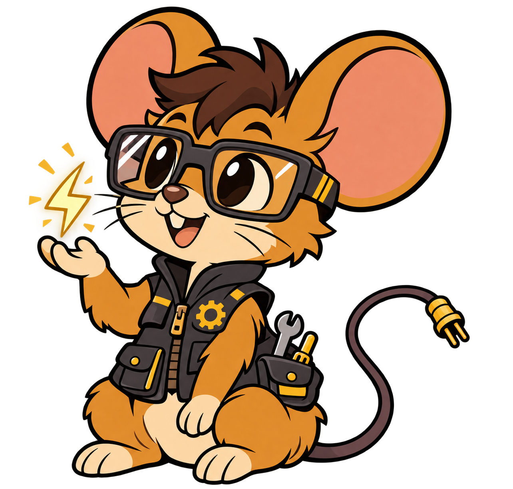

  

  <strong>Full-stack dev · Automation · Open source</strong> 
  <em>Building stuff that works.</em>

  
  &nbsp;&nbsp;
  
  &nbsp;&nbsp;
  

  <a href="#featured-projects">Projects</a> ·
  <a href="#tech-i-use">Toolbox</a> ·
  <a href="#github-stats">Stats</a>

 

<h2 align="center"></h2>

<strong>Frontend</strong>  
  
  
  
  
  
  
  
  

<strong>Backend</strong>  
  
  
  
  

<strong>Languages</strong>  
  
  
  
  
  
  
  
  
  
  
  
  

<strong>Tools</strong>  
  
  
  
  
  
  
  

 

<h2 align="center"></h2>

I’m a developer who likes building real projects, not just tutorials.  
I enjoy working across the stack and making systems that are simple, fast, and easy to maintain.

- Building frontends & backends  
- Automating boring stuff  
- Contributing to open source when I can  
- Experimenting with AI, infra, and new tools  

 

 

<h2 align="center"></h2>

  &nbsp; <strong><a href="https://github.com/Viddax/viddax">Viddax</a></strong> &middot; Ad-free desktop app for downloading media. 
  &nbsp; <strong><a href="https://github.com/nerdblud/GGRAB">GGRAB</a></strong> &middot; Go terminal UI for pulling selected files or folders from Git repos. 
  &nbsp; <strong><a href="https://github.com/hat3m3/opentiger">OpenTiger</a></strong> &middot; Python terminal toolkit for network reconnaissance, website checks, OSINT, and file inspection.

<a href="https://github.com/nerdblud?tab=repositories">Browse all repositories &#8599;</a>

 

<h2 align="center"></h2>

  
  &nbsp;&nbsp;
  

 

  <i>Making things easier for you — no need to thank me.</i>

